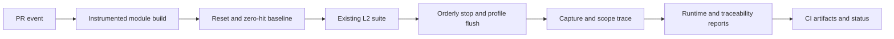

# Reference Analysis: Remote Debugger

This is a source-grounded reference for the reusable skill, not a template to
copy verbatim into another module. Paths below refer to the Remote Debugger
repository and are not dependencies of the installed skill.

## Verified Measurement Path

| Owner | Observed behavior |
|---|---|
| `.github/workflows/L2-tests.yml` | Runs on PRs targeting `develop` and pushes to `develop`; checks out dependencies and starts mock-xconf/native-platform containers |
| `cov_build.sh` | Builds the `remotedebugger` target with `--coverage` at compile and link time, `USECOV`, and `USE_L2_SUPPORT` |
| `run_l2.sh` | Enables `RRD_COVERAGE_MODE`, resets counters under `src`, captures an initial LCOV baseline, and executes sequential pytest files |
| `test/functional-tests/tests/helper_functions.py` | Changes the default kill behavior in coverage mode to permit a SIGTERM shutdown |
| `src/rrdMain.c` | Under `USECOV`, registers a SIGTERM handler that calls `__gcov_dump()` before exit |
| `run_l2.sh` collection | Captures runtime data, merges the zero baseline, removes `/usr/*`, writes `/tmp/l2_coverage/coverage.info`, and renders HTML with `genhtml` |
| Workflow reporting | Copies the container trace to the runner and invokes the shared Python generator |
| `test/functional-tests/l2_coverage_details.json` | Supplies component labels, source order, handwritten behavior tables, recommendations, and infrastructure notes |

The shared generator is checked out from
`rdkcentral/docker-device-mgt-service-test` at `develop`. Its invocation in the
workflow is:

```bash
python3 docker-device-mgt-service-test/generate_l2_coverage_report.py \
  --component "Remote Debugger" \
  --report-details remote_debugger/test/functional-tests/l2_coverage_details.json \
  --tracefile /tmp/coverage.info \
  --src-dir remote_debugger/src \
  --features-dir remote_debugger/test/functional-tests/features \
  --tests-dir remote_debugger/test/functional-tests/tests \
  --output remote_debugger/test/functional-tests/L2_Coverage.md
```

This command was inspected, not executed during skill creation. The external
generator source and its current schema were not inspected, so its parser
capabilities and mapping accuracy must be checked at the selected revision
when onboarding a target module.

## Reusable Core



The portable contract is instrumentation, isolated execution, reliable profile
flush, complete source denominator, normalized runtime trace, and PR-visible
evidence. Component names, dependencies, test lists, service control, container
paths, source filters, and behavior metadata are module-specific adapters.

## Risks In The Current Implementation

These observations explain the safeguards in the skill. The skill addition does
not modify or claim to fix this component's existing workflow.

1. **Test failures can be masked.** The runner executes many pytest commands
   without an aggregate failure status or fail-fast control. Later successful
   coverage commands and the final echo can leave the shell returning success.
2. **Missing coverage can be silent.** Trace copying uses `continue-on-error`;
   generation is skipped if copying fails. A green run is therefore not proof
   that coverage was produced. Earlier failed workflow steps can also prevent
   later default-conditioned collection steps from running.
3. **Publication requires writes.** The workflow requests `contents: write` and
   commits/pushes the report on pushes and same-repository PRs. Fork PRs skip
   that commit step, but there is no coverage-artifact upload step. HTML remains
   in the container. Artifact publication is a safer reusable default.
4. **Static assessments are not runtime evidence.** The metadata contains
   handwritten YES/NO/PARTIAL behavior tables and a `~100%` display target.
   These do not independently establish measured behavior coverage or a CI gate.
5. **Signal flushing is not universally safe.** The observed signal handler
   directly calls the coverage runtime. Do not assume that operation is
   async-signal-safe or suitable for a different process/thread lifecycle.
6. **Version references drift.** The workflow uses the shared repository's
   `develop` branch, while the HLD's local instructions mention
   `feature/l2docupdate`. Images use `latest`. Verify and pin appropriate
   revisions rather than treating documentation as the active implementation.
7. **Scope must be checked per module.** Coverage flags explicitly target the
   daemon, while the collector scans `src` and removes `/usr/*`. This does not
   by itself prove every production binary/library is instrumented or that all
   dependencies and test sources are excluded correctly in another repository.

## Boundaries

The framework measures aggregate code coverage from the L2 run. It is not
automatically changed-line coverage, a coverage-regression gate, per-scenario
function attribution, or proof that all mapped BDD scenarios passed. The reusable
skill requires separate evidence or explicit policy for each of those claims.
